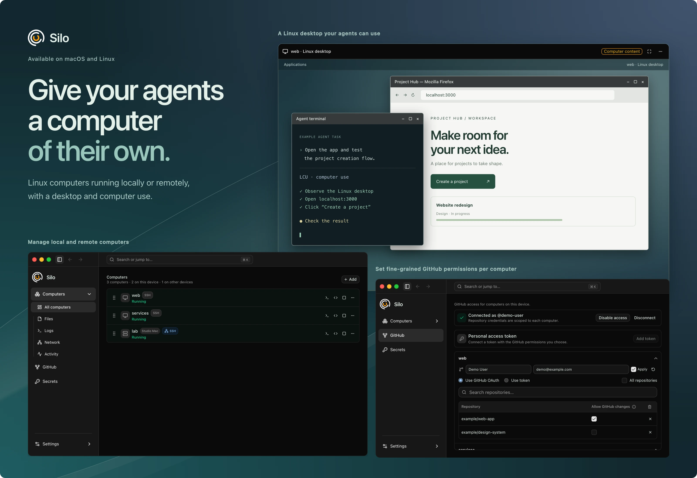

# Silo

Isolated computers for AI agents. Run untrusted code with a desktop and computer use, branch checkpoints, and diff states.

Silo gives each AI agent its own sandboxed Linux or macOS virtual machine—away from your host, with scoped repositories, credentials it can use but never read, and checkpoints you can branch, diff, and fold back like a Git repo.

Apps embed Silo through `silod`, a daemon they talk to over a local socket with a versioned JSON protocol. [Fjord](https://github.com/amontlabs/fjord) is built on it.

**Status.** Work in progress, MIT licensed, built by one person. The host is macOS on Apple Silicon today. On Linux, the `silo-engine` crate builds and passes its tests in CI; a Linux `silod` is the next milestone.

[Why Silo](#why-silo) · [Threat model](docs/THREAT-MODEL.md) · [Isolation evals](docs/evals/README.md) · [Security policy](SECURITY.md) · [Roadmap](docs/ROADMAP.md) · [Engine releases](https://github.com/amontlabs/silo/releases?q=engine-v&expanded=true) · [Documentation](docs/README.md) · [Silo app](#silo-app) · [Website](https://silo.amontlabs.com)

## Why Silo

### The problem

Coding agents are prompt-injected through the channels they are meant to read: issues, pull request comments, web pages, dependencies. In [Comment and Control](https://oddguan.com/blog/comment-and-control-prompt-injection-credential-theft-claude-code-gemini-cli-github-copilot/) (April 2026), text in pull request titles and issue comments made Claude Code, Gemini CLI and GitHub Copilot agents running in GitHub Actions leak API keys and GitHub tokens back through GitHub itself, as comments or commits; Copilot's egress allowlist permitted GitHub, so it did not help ([CSA research note](https://labs.cloudsecurityalliance.org/research/csa-research-note-comment-control-github-prompt-injection-20/)). Separately, the UK AI Security Institute's [SandboxEscapeBench](https://www.aisi.gov.uk/blog/can-ai-agents-escape-their-sandboxes-a-benchmark-for-safely-measuring-container-breakout-capabilities) found that frontier models reliably escape common container misconfigurations, such as privileged containers, writable host mounts and exposed Docker sockets ([paper](https://arxiv.org/abs/2603.02277)).

The sandboxes built into agent harnesses limit which files and hosts the agent's processes can touch, and some, such as srt, also hide a secret's value. None narrows what a credential is authorised to do: a token that can push to every repository still can, from inside the sandbox.

### What Silo does

Silo assumes the agent in a computer is hostile and has root there. It then limits what that agent can reach and what it is authorised to do:

- **A virtual machine per computer.** Linux computers are libkrun microVMs (through [MicroSandbox](https://github.com/superradcompany/microsandbox)); macOS computers run on Apple's Virtualization framework. Each has its own kernel and its own disk. No folder of yours is shared in. A Linux guest sees the runtime's own control folder (`/.msb`, read-write, not yet separately reviewed) and, on computers created before Cua Driver, two empty read-only tool folders.
- **Credentials the agent can use but not read.** Secret values stay in the Mac's Keychain. The guest gets a placeholder; the runtime on the Mac swaps in the real value only in the headers of HTTPS requests to that secret's allowed hosts, after verifying the server's identity. An explicitly acknowledged "any host" assignment turns this off for that secret. This is MicroSandbox's placeholder mechanism, which Silo configures and patches.
- **GitHub access per computer and per repository, read-only by default.** Silo mints scoped child tokens on the Mac for the repositories you select; the guest never sees a GitHub token. Write access is a per-repository opt-in. The [GitHub scope eval](docs/evals/results/2026-11-03-74bd4f0a.md) found that a Linux guest in OAuth mode could read a granted repository but push to neither it nor an ungranted one; personal-token mode was not covered.
- **No route to your Mac or your network.** Guests reach public IP addresses only: not the Mac's loopback, private-range (LAN, VPN), link-local or cloud-metadata addresses, or other computers. DNS queries reach the Mac's resolvers, but answers with private or reserved addresses are blocked. DNS remains an unfiltered outbound channel, and a LAN host with a public address counts as public. macOS computers get this once their setup completes.
- **A way back.** Checkpoint a computer before letting an agent loose, restore it, or fork a copy.
- **A local engine, no Silo account.** The engine runs on your Mac. Apps drive it through one same-user socket.

Each mechanism, with the code that implements it, is in the [threat model](docs/THREAT-MODEL.md).

### What Silo does not protect

- **Data the agent can read can leave.** There is no egress allowlist yet: a guest can send anything it can read to any public host, including through a host it is allowed to use. The [eval](docs/evals/README.md) shows a `/workspace` file posted to a public echo service.
- **Credentials can be used.** A scoped secret or GitHub token works for the agent within its scope: it can spend credits or write to a repository you granted for changes.
- **Allowed hosts that echo headers reveal secrets.** If an allowed host reflects the request back, the guest reads the real value. The eval reproduces this.
- **Write grants reach CI.** A repository granted for changes includes `workflows: write`, so the agent can edit its Actions workflows and use whatever they can reach.
- **Personal access tokens are not scoped.** A computer that uses a personal token gets the token's full permissions.
- **Other processes on your Mac are trusted.** Any process running as your user can drive the engine socket; there is no per-client authentication or audit log yet. Same-user malware, hypervisor escapes and hostile apps that embed the engine are out of scope.
- **Also out of scope.** Outbound bandwidth and connection counts are not capped. Imported macOS computer archives are mounted on the Mac, so import only archives you trust. Published ports are reachable by any local process. A VM escape gives the attacker your user account, because the runtime runs as you without the App Sandbox.
- **macOS computers during setup.** Until setup completes, and in Recovery, a macOS computer uses Apple's NAT and can reach the Mac and the LAN.
- **The guest itself.** The agent is root in its computer and can change anything there, including the tools Silo installed. Roll back with checkpoints.

The [threat model](docs/THREAT-MODEL.md) lists every limit, and the [eval results](docs/evals/README.md) say which ones were tested and how.

### How it compares

Silo has no single feature that nobody else has, and it builds on MicroSandbox, whose placeholder secrets it uses. What it combines is per-repository GitHub authority, Linux and macOS guests, and an embeddable, local, MIT-licensed engine. Several tools below already have the egress allowlist Silo lacks.

| | Isolation | Runs on | Credentials in the sandbox | Outbound network | Desktop and computer use | macOS guests | License |
| --- | --- | --- | --- | --- | --- | --- | --- |
| **Silo** | VM per computer (libkrun; Virtualization framework) | Apple Silicon Mac | Placeholders, swapped on the host for allowed HTTPS hosts; GitHub tokens minted per repository, read-only by default | Public addresses only; no allowlist yet | Yes (Cua Driver, Linux and macOS) | Yes | MIT |
| **[Docker Sandboxes](https://docs.docker.com/ai/sandboxes/)** (`sbx`) | microVM per sandbox [^docker-iso] | macOS, Windows, Linux; Docker cloud | Sentinel, swapped by a host proxy [^docker-arch] | Deny by default, allowlist; org policy is paid [^docker-def] | Not documented | No | Proprietary; local use free |
| **[Cua](https://github.com/trycua/cua)** | VMs (Lume, QEMU) or microVMs (Firecracker, vz, Containerization); gVisor or runc containers [^cua-how] | Mac, Linux, Windows; own cloud (Cua Cloud ended 18 Oct 2026 [^cua-cloud]) | Plain env vars or temp files; Keyvault releases signed-in app sessions after approval; no proxy injection documented [^cua-secrets] | Open by default; IP and CIDR allow and deny lists on Linux runtimes, not yet on macOS VMs [^cua-egress] | Yes, its core purpose | Yes | MIT core; some parts FSL-1.1-MIT |
| **[srt](https://github.com/anthropic-experimental/sandbox-runtime)** | OS sandbox (Seatbelt; bubblewrap and seccomp; WFP on Windows), shared kernel; beta | macOS, Linux; Windows alpha | Deny, or mask with a sentinel swapped on egress | Deny by default, domain allowlist; blocks loopback, link-local, metadata | Not documented | N/A (no VM) | Apache-2.0 |
| **[microsandbox](https://github.com/superradcompany/microsandbox)** | microVM (libkrun) | macOS, Linux, Windows | Secrets bound to allowed hosts; its README says they never enter the VM | Public internet by default (private, host and metadata blocked); opt-in host and port allowlist [^msb-net] | Not built in; VNC desktop how-to | No (Linux guests) | Apache-2.0 |
| **[E2B](https://e2b.dev/open-source)** | Firecracker microVM | Hosted; self-host or BYOC | Reference, swapped into headers by an egress proxy [^e2b-secret] | Open by default; allow and deny lists [^e2b-net] | Yes (E2B Desktop) [^e2b-desk] | Not documented | Apache-2.0 core; hosted service commercial |
| **[Daytona](https://www.daytona.io/docs/en/isolation)** | Container, or VM with its own kernel | Hosted; own compute (opt-in) with Daytona's control plane [^daytona-byoc] | Placeholder, swapped by an outbound proxy for allowed hosts [^daytona-secrets] | Firewall, allowlists; default depends on tier [^daytona-net] | Yes (VNC, computer use) [^daytona-vnc] | Yes, on dedicated Macs (per-organization opt-in) [^daytona-macos] | Hosted service proprietary; open-source repo (AGPL-3.0) no longer maintained [^daytona-repo] |
| **[Apple container](https://github.com/apple/container)** | Lightweight VM per container | Apple silicon, macOS 26 | Not documented | No egress filter documented [^apple-tech] | Not documented | No | Apache-2.0 |

Researched 2026-11-03 from each project's own documentation; corrections welcome in an issue.

[^docker-iso]: [Docker Sandboxes isolation layers](https://docs.docker.com/ai/sandboxes/security/isolation/); hosts from [install](https://docs.docker.com/ai/sandboxes/install/).
[^docker-arch]: [Docker Sandboxes architecture](https://docs.docker.com/ai/sandboxes/architecture/).
[^docker-def]: [Docker Sandboxes default security posture](https://docs.docker.com/ai/sandboxes/security/defaults/).
[^cua-cloud]: [Cua Cloud has ended](https://cua.ai/docs/cua-sdk/guides/cua-cloud-ended); providers in [self-hosted sandboxes](https://cua.ai/docs/cua/guide/get-started/self-hosted-sandboxes).
[^cua-how]: [How Cua sandboxes work](https://cua.ai/docs/cua-sdk/concepts/how-sandboxes-work).
[^cua-secrets]: [Cua sandbox secrets](https://cua.ai/docs/cua/guide/sandbox/secrets).
[^cua-egress]: [Cua egress policy](https://cua.ai/docs/cua-sdk/guides/egress).
[^msb-net]: [microsandbox networking](https://github.com/superradcompany/microsandbox/blob/main/docs/networking/overview.mdx).
[^e2b-secret]: [E2B secret injection](https://docs.e2b.dev/secrets/inject).
[^e2b-net]: [E2B internet access](https://docs.e2b.dev/network/internet-access).
[^e2b-desk]: [E2B computer use](https://docs.e2b.dev/use-cases/computer-use).
[^daytona-net]: [Daytona network limits](https://www.daytona.io/docs/en/network-limits).
[^daytona-byoc]: [Daytona bring your own compute](https://www.daytona.io/docs/en/bring-your-own-compute/).
[^daytona-secrets]: [Daytona secrets](https://www.daytona.io/docs/en/secrets).
[^daytona-macos]: [Daytona macOS sandboxes](https://www.daytona.com/docs/macos-sandboxes).
[^daytona-vnc]: [Daytona VNC access](https://www.daytona.io/docs/en/vnc-access).
[^daytona-repo]: [daytonaio/daytona](https://github.com/daytonaio/daytona): "This repository is no longer maintained."
[^apple-tech]: [Apple container technical overview](https://github.com/apple/container/blob/main/docs/technical-overview.md).

## What it does

- **Run computers.** Create, start, stop, and monitor virtual machines, each with its own files, tools, and processes, sandboxed from the Mac. Linux computers run on [MicroSandbox](https://github.com/superradcompany/microsandbox); macOS computers run on Apple's Virtualization framework. See [macOS computers](docs/SiloUI-MACOS-COMPUTERS.md).
- **Give agents a desktop.** Linux computers have a desktop built in, with computer use through [Cua Driver](https://github.com/trycua/cua) (MIT), registered with Claude Code and Codex when they are installed. macOS computers get the same Cua Driver after installation. See the [computer-use plan](docs/SiloUI-COMPUTER-USE-PLAN.md).
- **Reach a computer's files and services.** Browse files, open terminals, connect development servers to local addresses, and enable SSH access per computer.
- **Control GitHub access.** Connect through OAuth and select repositories for each computer, with read-only access by default, or use a [personal token](docs/SiloUI-GITHUB-PERSONAL-TOKENS.md), which grants the token's full permissions.
- **Scope API credentials.** Store credentials in the Mac's Keychain and choose the computers and HTTPS domains that can use them. See [how secrets work](docs/SiloUI-SECRETS.md).
- **Save and branch state.** Create checkpoints of a computer, restore it to an earlier checkpoint, or fork a new computer with a copy of its files.
- **Move computers and troubleshoot.** Export a computer or checkpoint and import it as a new computer on this or another Mac. Search or export logs alongside activity history.

## Platforms

| | Today | Next |
| --- | --- | --- |
| Host | macOS 15+ on Apple Silicon: engine releases and the Silo app | Linux host: `silo-engine` builds and passes its tests in CI; `silod` for Linux (systemd user service) and Linux engine releases are the next milestone |
| Guests | Linux (Ubuntu 24.04, arm64 on Apple Silicon) and macOS | Unchanged |
| Intel Macs | Not supported | Not planned |

Silo app releases up to v0.11.1 also shipped Linux `.deb` and AppImage packages. Those builds predate the engine and are frozen at v0.11.1: they get no further updates, and their APT source is no longer re-signed, so `apt update` reports it as expired. Remove it with `sudo rm /etc/apt/sources.list.d/silo.sources`.

## How it fits together

- **`silod`** is the engine daemon. One runs per Mac and build channel, started by launchd as a LaunchAgent. It owns the computers, credentials, and VM windows, and keeps running when the apps that use it quit.
- **Socket and protocol.** Clients connect to `~/.silo/engine.sock` and exchange JSON frames, each prefixed with a 4-byte big-endian length. A handshake negotiates the protocol version (currently 7). Requests and responses are matched by id; the engine also pushes job progress and events. Methods are grouped by area, such as `computers`, `checkpoints`, `desktop`, `github`, `secrets`, and `exports` ([`api/src/methods`](app/SiloUI/api/src/methods)).
- **Crates** in the [`app/SiloUI`](app/SiloUI) Cargo workspace:
  - `silo-api` ([`api`](app/SiloUI/api)): the wire contract as serde types, the generated [JSON schema](app/SiloUI/api/schema/silo-api.schema.json), and a typed request constructor for each method.
  - `silo-client` ([`client`](app/SiloUI/client)): a thin Rust client with framing, the handshake, request correlation, and the event feed.
  - `silo-host` ([`host`](app/SiloUI/host)): stateless host helpers shared by the app and the engine (channel names, applications, notifications, system integrations, terminal launch).
  - `silo-engine` ([`src-tauri/engine`](app/SiloUI/src-tauri/engine)): the engine library, without Tauri.
  - `silod` ([`src-tauri/silod`](app/SiloUI/src-tauri/silod)): the daemon.
  - `silo-ui` ([`src-tauri`](app/SiloUI/src-tauri)): the Tauri desktop app, a client of `silod`.

See [Silo engine](docs/SiloUI-ENGINE.md) for the boundary between the engine and its clients.

## Embed the engine

1. **Download an engine release.** Engine releases are tagged `engine-v<version>`, separately from the app. Each has `silo-engine-<version>-macos-arm64.tar.gz` and its `.sha256`. The archive contains `bin/silod` (arm64, unsigned), its Info.plist, entitlements, LaunchAgent plist, engine manifest, `release.json` with the supported protocol range, and the API schema. To work against unreleased Silo, build the same archive with `app/SiloUI/scripts/package-engine.py`.
2. **Bundle and sign it in your app.** Package `silod` as a nested engine app with its LaunchAgent plist, set `SiloEngineCodeRequirement` in its Info.plist to match your signature, and sign it with the provided entitlements. A production engine refuses to start without that requirement. Register the LaunchAgent from your app; if an engine already serves the socket, use it.
3. **Connect to the socket.** Open `~/.silo/engine.sock`, send `engine.handshake` with the protocol range you support, then send requests and subscribe to events.
4. **Generate a client.** Rust apps can depend on `silo-client` and `silo-api`. Other languages can generate types from [`silo-api.schema.json`](app/SiloUI/api/schema/silo-api.schema.json), which ships in every engine release.

See [engine releases](docs/SiloUI-RELEASES.md#engine-releases) for the archive layout and signer requirement, and the [`silo-api` README](app/SiloUI/api/README.md) for the contract crate.

## Silo app

The Silo app is a desktop app built on the engine. It manages local and remote computers, opens projects in your editor and terminal, and shows each computer's desktop.



### Install

The engine, computer runtime, and Git tools are bundled. The base Linux image (about 350 MB) downloads once in the background before your first computer, is checked against a pinned checksum, and is reused until an update pins a new image. For computer use, new Linux computers have Cua Driver built into their image; a computer created from an earlier image fetches Cua Driver's pinned, checksummed release archive (about 37 MB) from GitHub once at first start. For macOS computers, Silo downloads Cua Driver's pinned, checksummed macOS archive (about 85 MB) once to this Mac and installs it during setup. Computers created before the built-in desktop download optional desktop packages when you add a desktop.

| Platform | Requirements | Download |
| --- | --- | --- |
| macOS | Apple Silicon, macOS 15+ | [DMG](https://github.com/amontlabs/silo/releases/latest/download/Silo-macos-arm64.dmg) |

Releases before v0.12.0 downloaded ChatGPT for Linux from OpenAI for computer use; v0.12.0 replaced it with Cua Driver.

**macOS:** open the DMG and drag Silo to Applications. The app is not notarized; first launch may require **System Settings → Privacy & Security → Open Anyway**.

Upgrading an older installation? Saved data is converted automatically on first launch, but exports from earlier versions cannot be imported. Read the [release notes](https://github.com/amontlabs/silo/releases/latest) for required migration steps.

To create a computer, open a project, and connect another device, see [Using the Silo app](docs/SiloUI-APP.md).

## Develop Silo

The engine and app are Rust, and the app's interface is React/TypeScript with Tauri, all in [`app/SiloUI`](app/SiloUI). Follow the [source-build guide](docs/SiloUI-BUILD-FROM-SOURCE.md) to install prerequisites and configure your own GitHub App, then run from the repository root:

```sh
npm --prefix app/SiloUI ci
npm --prefix app/SiloUI run desktop
```

For checks and release procedures, including engine releases, see the [development and release guide](docs/SiloUI-RELEASES.md). For the browser demo, see the [website README](website/README.md).

## Help and license

Check **Logs** and **Activity** for errors. [Report an issue](https://github.com/amontlabs/silo/issues) with your app version, OS, and reproduction steps; remove private data from shared logs.

Silo is [MIT licensed](LICENSE). Bundled dependencies have their own [licenses and notices](app/SiloUI/THIRD-PARTY-NOTICES.md).
