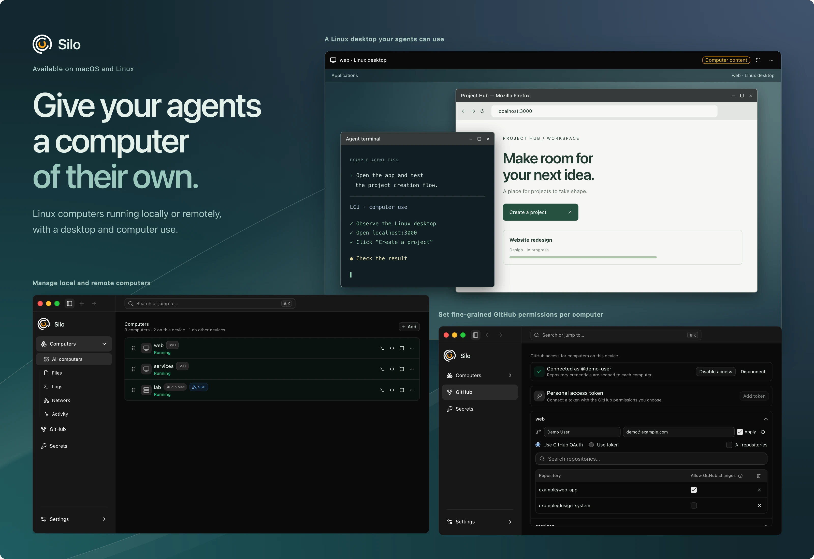

# Silo

Computers for agents. Silo is an engine that runs sandboxed Linux and macOS virtual machines on Apple Silicon Macs, each with its own files, tools, desktop and computer use, and controls access to your repositories and credentials.

Apps embed Silo through `silod`, a daemon they talk to over a local socket with a versioned JSON protocol. [Fjord](https://github.com/amontlabs/fjord) is built on it.

[Engine releases](https://github.com/amontlabs/silo/releases?q=engine-v&expanded=true) · [Documentation](docs/README.md) · [Silo app](#silo-app) · [Website and demo](https://silo.amontlabs.com)

## What it does

- **Run computers.** Create, start, stop, and monitor virtual machines, each with its own files, tools, and processes, sandboxed from the Mac. Linux computers run on [MicroSandbox](https://github.com/superradcompany/microsandbox); macOS computers run on Apple's Virtualization framework. See [macOS computers](docs/SiloUI-MACOS-COMPUTERS.md).
- **Give agents a desktop.** New Linux computers have a desktop built in, with computer use for agents; Silo downloads ChatGPT for Linux from OpenAI and sets up computer use once the computer is ready. macOS computers are set up for computer use after installation. See the [computer-use plan](docs/SiloUI-COMPUTER-USE-PLAN.md).
- **Reach a computer's files and services.** Browse files, open terminals, connect development servers to local addresses, and enable SSH access per computer.
- **Control GitHub access.** Connect through OAuth and select repositories for each computer, with read-only access by default, or use a [personal token](docs/SiloUI-GITHUB-PERSONAL-TOKENS.md), which grants the token's full permissions.
- **Scope API credentials.** Store credentials in the Mac's Keychain and choose the computers and HTTPS domains that can use them. See [how secrets work](docs/SiloUI-SECRETS.md).
- **Save and branch state.** Create checkpoints of a computer, restore it to an earlier checkpoint, or fork a new computer with a copy of its files.
- **Move computers and troubleshoot.** Export a computer or checkpoint and import it as a new computer on this or another Mac. Search or export logs alongside activity history.

## How it fits together

- **`silod`** is the engine daemon. One runs per Mac and build channel, started by launchd as a LaunchAgent. It owns the computers, credentials, and VM windows, and keeps running when the apps that use it quit.
- **Socket and protocol.** Clients connect to `~/.silo/engine.sock` and exchange JSON frames, each prefixed with a 4-byte big-endian length. A handshake negotiates the protocol version (currently 6). Requests and responses are matched by id; the engine also pushes job progress and events. Methods are grouped by area, such as `computers`, `checkpoints`, `desktop`, `github`, `secrets`, and `exports` ([`api/src/methods`](app/SiloUI/api/src/methods)).
- **Crates** in the [`app/SiloUI`](app/SiloUI) Cargo workspace:
  - `silo-api` ([`api`](app/SiloUI/api)): the wire contract as serde types, the generated [JSON schema](app/SiloUI/api/schema/silo-api.schema.json), and a typed request constructor for each method.
  - `silo-client` ([`client`](app/SiloUI/client)): a thin Rust client with framing, the handshake, request correlation, and the event feed.
  - `silo-host` ([`host`](app/SiloUI/host)): stateless host helpers shared by the app and the engine (channel names, applications, notifications, system integrations, terminal launch).
  - `silo-engine` ([`src-tauri/engine`](app/SiloUI/src-tauri/engine)): the engine library, without Tauri.
  - `silod` ([`src-tauri/silod`](app/SiloUI/src-tauri/silod)): the daemon.
  - `silo-ui` ([`src-tauri`](app/SiloUI/src-tauri)): the Tauri desktop app, a client of `silod`.

See [Silo engine](docs/SiloUI-ENGINE.md) for the boundary between the engine and its clients.

## Embed the engine

1. **Download an engine release.** Engine releases are tagged `engine-v<version>`, separately from the app. Each has `silo-engine-<version>-macos-arm64.tar.gz` and its `.sha256`. The archive contains `bin/silod` (arm64, unsigned), its Info.plist, entitlements, LaunchAgent plist, engine manifest, `release.json` with the supported protocol range, and the API schema. To work against unreleased Silo, build the same archive with `app/SiloUI/scripts/package-engine.py`.
2. **Bundle and sign it in your app.** Package `silod` as a nested engine app with its LaunchAgent plist, set `SiloEngineCodeRequirement` in its Info.plist to match your signature, and sign it with the provided entitlements. A production engine refuses to start without that requirement. Register the LaunchAgent from your app; if an engine already serves the socket, use it.
3. **Connect to the socket.** Open `~/.silo/engine.sock`, send `engine.handshake` with the protocol range you support, then send requests and subscribe to events.
4. **Generate a client.** Rust apps can depend on `silo-client` and `silo-api`. Other languages can generate types from [`silo-api.schema.json`](app/SiloUI/api/schema/silo-api.schema.json), which ships in every engine release.

See [engine releases](docs/SiloUI-RELEASES.md#engine-releases) for the archive layout and signer requirement, and the [`silo-api` README](app/SiloUI/api/README.md) for the contract crate.

## Silo app

The Silo app is a desktop app built on the engine. It manages local and remote computers, opens projects in your editor and terminal, and shows each computer's desktop.



### Install

The engine, computer runtime, base Linux image, and Git tools are bundled. Silo downloads ChatGPT for Linux in the background for computer use. Computers created before the built-in desktop download optional desktop packages when you add a desktop.

| Platform | Requirements | Download |
| --- | --- | --- |
| macOS | Apple Silicon, macOS 14+ | [DMG](https://github.com/amontlabs/silo/releases/latest/download/Silo-macos-arm64.dmg) |

**macOS:** open the DMG and drag Silo to Applications. The app is not notarized; first launch may require **System Settings → Privacy & Security → Open Anyway**.

Upgrading an older installation? Saved data is converted automatically on first launch, but exports from earlier versions cannot be imported. Read the [release notes](https://github.com/amontlabs/silo/releases/latest) for required migration steps.

To create a computer, open a project, and connect another device, see [Using the Silo app](docs/SiloUI-APP.md).

## Develop Silo

The engine and app are Rust, and the app's interface is React/TypeScript with Tauri, all in [`app/SiloUI`](app/SiloUI). Follow the [source-build guide](docs/SiloUI-BUILD-FROM-SOURCE.md) to install prerequisites and configure your own GitHub App, then run from the repository root:

```sh
npm --prefix app/SiloUI ci
npm --prefix app/SiloUI run desktop
```

For checks and release procedures, including engine releases, see the [development and release guide](docs/SiloUI-RELEASES.md). For the browser demo, see the [website README](website/README.md).

## Help and license

Check **Logs** and **Activity** for errors. [Report an issue](https://github.com/amontlabs/silo/issues) with your app version, OS, and reproduction steps; remove private data from shared logs.

Silo is [MIT licensed](LICENSE). Bundled dependencies have their own [licenses and notices](app/SiloUI/THIRD-PARTY-NOTICES.md).
