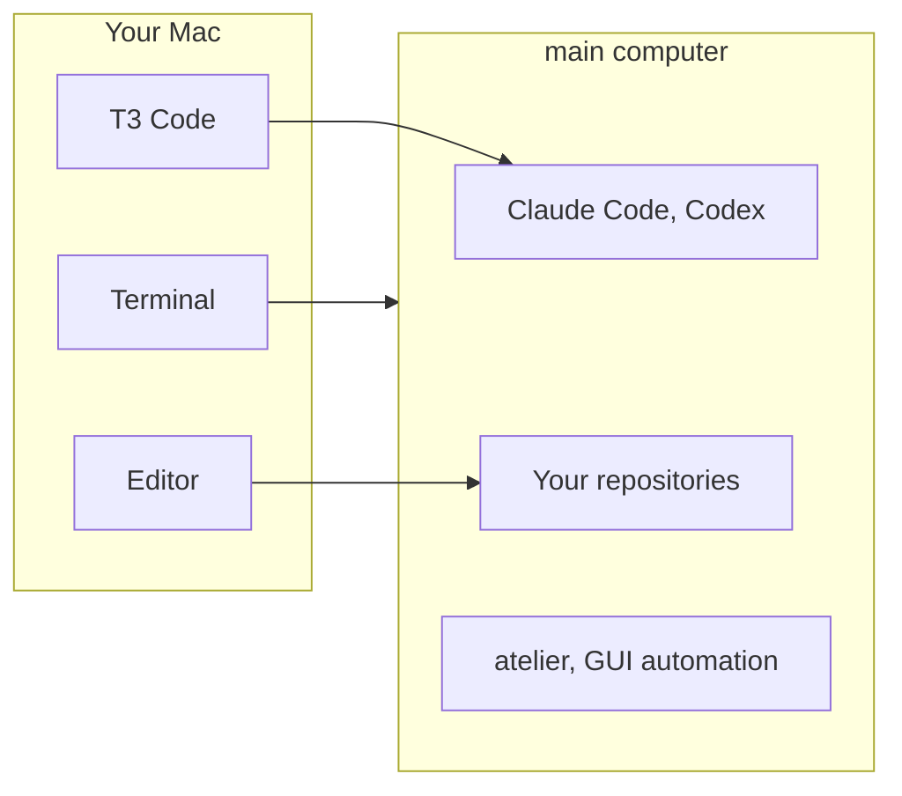
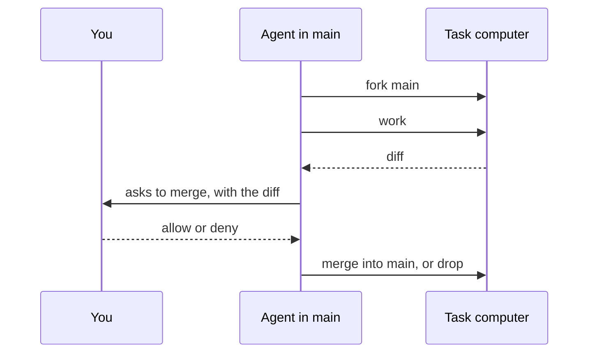
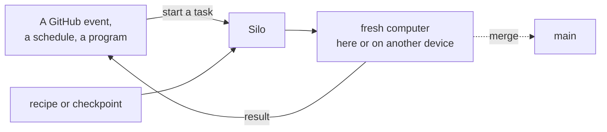

# Journeys

How Silo is used, step by step. Each step carries what is true today:

- `[built]`: someone drove it as a user and it works.
- `[partial]`: it works with gaps, named on the line.
- `[missing]`: it does not exist.
- `[untested]`: the code and its docs say it exists; nobody has driven it as a user since it was
  written.

Format, for agents: a journey is a `## ` heading with an `<!-- id: … -->` line under it. A step
is a list item that starts with its status. A change that alters what a user does or sees
updates the step in the same merge. The owner's dashboard reads this file.

Status: the audit of 2026-11-16 drove the command-line steps on the Dev build. The app window,
editors, GitHub access, secrets and other devices are not driven yet.

## 1. You live in a computer
<!-- id: live -->

Your setup is inside main, and your tools open into it as easily as they open a local folder.
You stop working on your own machine.

- [partial] Install Silo; the first run makes main. `silo up` makes main in under a minute. A
  rebuilt Dev app can open on "Silo could not load" when an older engine left its record behind.
  The app's own first run is not driven yet.
- [partial] Pick Claude Code or Codex; Silo installs it in main and opens it. `silo agents install`
  works and Silo's tools are connected in the agent. Opening it from the app is not driven yet.
- [missing] T3 Code on the Mac connects to the agent inside main.
- [untested] Your editor (VS Code, Zed) opens a folder in main.
- [built] A terminal opens in main (`ssh main.silo-dev`).
- [untested] Your repositories are reachable from main with GitHub access per repository.
- [untested] Secrets work inside main without being readable there.
- [untested] GUI automation runs inside main (desktop and computer use).
- [missing] atelier runs inside main. The default recipe has no Node, so most tools need setup first.
- [missing] One recipe sets all of the above up, so a new main is ready to use.
- [partial] Making a recipe: a YAML file added with `silo recipe add`. There is no guided way to
  create one.

## 2. A computer per task
<!-- id: task -->

You or your agent make another computer for a task, work there, and bring the result back.

- [built] The agent in main forks main without asking you.
- [untested] The agent makes a disposable computer from a recipe. It works from the Mac; not
  driven from inside main.
- [partial] The agent runs commands in the fork and reads its logs and screen. Commands work;
  logs and screen are not driven yet.
- [partial] The diff shows code, packages, settings, files and databases. Code, packages and
  settings are shown; databases are not driven yet.
- [partial] Merging asks you in the Silo app, with the diff. The request is held and listed on the
  Mac; the app's Pending page is not driven yet.
- [built] Merge when main has not changed: every change is applied and main keeps running.
- [untested] Merge when main has changed: item by item, and you choose on conflicts.
- [partial] Undo a merge, drop a fork, replace main. Undo and drop work; a running fork must be
  stopped before it can be dropped. Replace main is not driven yet.
- [untested] You do each of these yourself, from the app or with `silo`.
- [untested] Several task computers run at once without colliding.

## 3. A task started from outside
<!-- id: outside -->

Something outside Silo starts a task in a fresh computer and gets the result. The computer starts
from a recipe or a checkpoint, so there is no setup to wait for.

Example: someone opens a pull request. A computer starts from a checkpoint that already has the
repository installed, pulls the pull request, tries it, writes a report and sends it to you. Its
work can also be merged into main.

- [built] A recipe is built once and later computers fork from its checkpoint.
- [built] A computer starts from a checkpoint you chose, and can run a command as it starts.
- [missing] One call starts a task: which recipe or checkpoint, what to run, where the result
  goes. Today a caller chains several `silo` commands itself, a recipe and a command cannot go in
  one call, and the computer stays running afterwards.
- [untested] The same call works on another device (`--device`, a Linux host).
- [partial] The caller gets the result back: exit status, a report, files. The exit status comes
  back; a report or files need a second command.
- [missing] The task's work is merged into main.
- [untested] GitHub Actions jobs run in fresh computers (`silo-runner`). This is the one trigger
  that exists, and it is specific to GitHub jobs.
- [missing] Fjord starts a task from a GitHub event.

## Outside the three journeys
<!-- id: other -->

Features that exist and are not part of a journey above. Each is reviewed in turn; see
[the product page](PRODUCT.md#everything-else). The audit completes this list.

- [untested] macOS computers.
- [untested] Container computers on Linux hosts.
- [untested] Computers on another device (Connections) and hosting computers for other devices.
- [untested] The desktop viewer.
- [untested] Sharing a computer as a file (export and import).
- [untested] Published websites and ports.
- [untested] Folder forks.
- [untested] Review requests and pull requests from a fork.
- [untested] The hosted reviewer service.
- [untested] Personal GitHub tokens.
- [untested] Network policy per computer.
- [untested] The audit log (Activity) and notifications.
